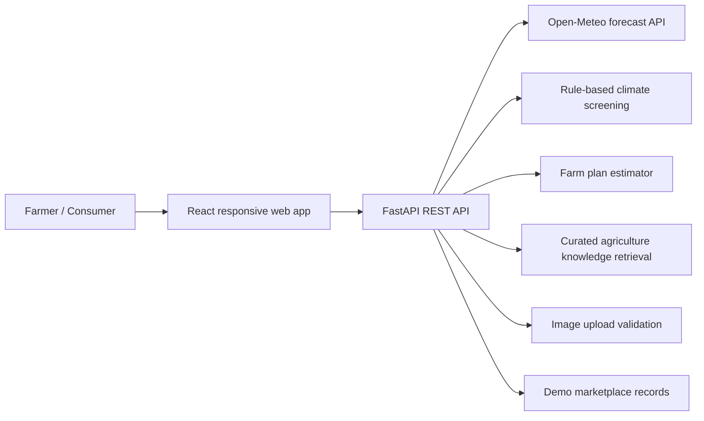

# AgriShield AI architecture

## Design principles

1. One product, two clear journeys: farmer operations and consumer shopping.
2. One primary navigation with seven task-oriented destinations.
3. Keep experimental or hardware-dependent concepts out of the first MVP.
4. Separate live external data from sample/demo records.
5. Never label a heuristic as a trained AI model, or a sample record as verified telemetry.
6. Keep crop treatment advice conservative and refer users to qualified local extension officers for diagnosis and pesticide decisions.

## Next production architecture

- PostgreSQL for users, farms, fields, crop cycles, sensor readings, produce, orders, harvest batches, and activity logs.
- Object storage for leaf images and traceability documents.
- Authentication with farmer/consumer/admin roles.
- Weather ingestion/cache and geospatial field registry.
- Model service for evaluated disease classification and climate-risk forecasting.
- RAG service with versioned, source-attributed BRRI, BARI, DAE, and SRDI materials.
- IoT gateway service with device identity, calibration metadata, and signed telemetry.
